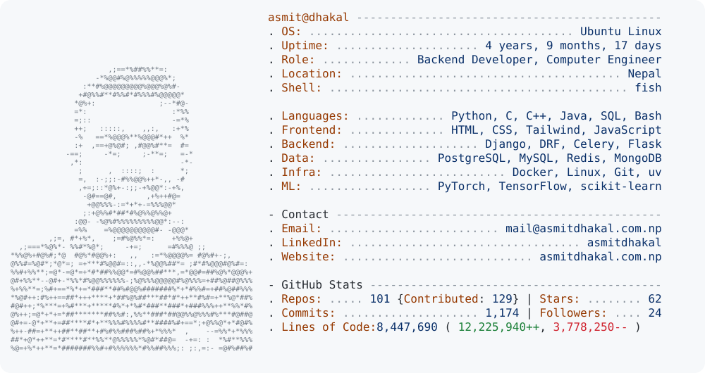

  <a href="https://github.com/Asmit-Dhakal">
    <picture>
      <source media="(prefers-color-scheme: dark)" srcset="dark_mode.svg">
      <source media="(prefers-color-scheme: light)" srcset="light_mode.svg">
      
    </picture>
  </a>

 

### 👨‍💻 About Me

  

- 🔭 I’m currently working on **[Krishikranti](https://github.com/Asmit-Dhakal/Krishikranti)**
- 🌱 I’m currently learning & building with **Deep Learning & Scalable Backend Systems**
- 👯 I’m looking to collaborate on **[Omdena](https://github.com/Omdena-NIC-Nepal)**
- 👨‍💻 Check out all my projects at **[github.com/Asmit-Dhakal](https://github.com/Asmit-Dhakal)**
- 💬 Ask me about **Django, DRF, Celery, PostgreSQL & Machine Learning**
- 📫 How to reach me: **[asmitdhakal123@gmail.com](mailto:asmitdhakal123@gmail.com)**
- 📄 Explore my experiences & portfolio at **[asmitdhakal.com.np](https://asmitdhakal.com.np)**
- ⚡ Fun fact: **I am funny**

 

### 🌐 Connect with me:

  
  
  
  

 

### 🛠️ Languages and Tools:

  
  
  
  
  
  
  
  
  
  
  
  
  
  
  
  
  
  
  
  
  
  
  
  

 

### 📊 GitHub Activity

  <picture>
    <source media="(prefers-color-scheme: dark)" srcset="https://github-readme-streak-stats.herokuapp.com/?user=asmit-dhakal&theme=dark&hide_border=true">
    <source media="(prefers-color-scheme: light)" srcset="https://github-readme-streak-stats.herokuapp.com/?user=asmit-dhakal&hide_border=true">
    
  </picture>
  <picture>
    <source media="(prefers-color-scheme: dark)" srcset="https://github-readme-stats.vercel.app/api/top-langs?username=asmit-dhakal&show_icons=true&locale=en&layout=compact&theme=github_dark&hide_border=true">
    <source media="(prefers-color-scheme: light)" srcset="https://github-readme-stats.vercel.app/api/top-langs?username=asmit-dhakal&show_icons=true&locale=en&layout=compact&hide_border=true">
    
  </picture>

